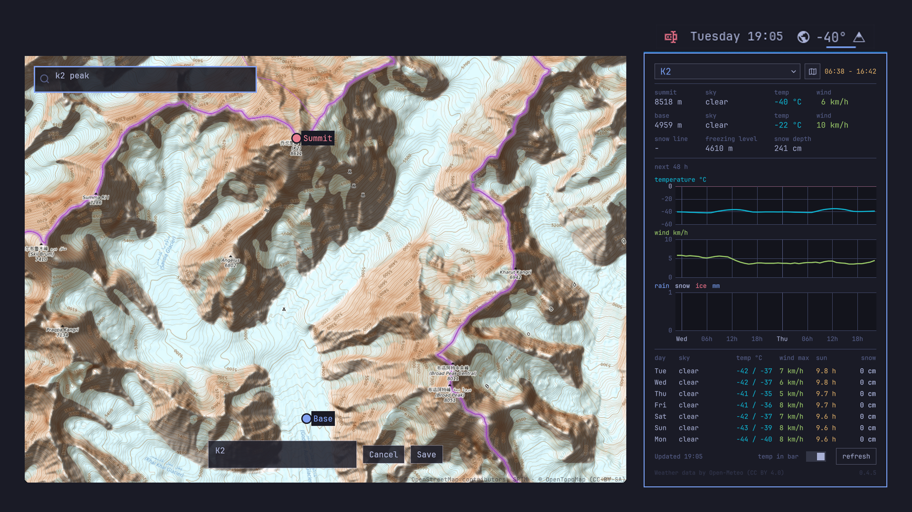
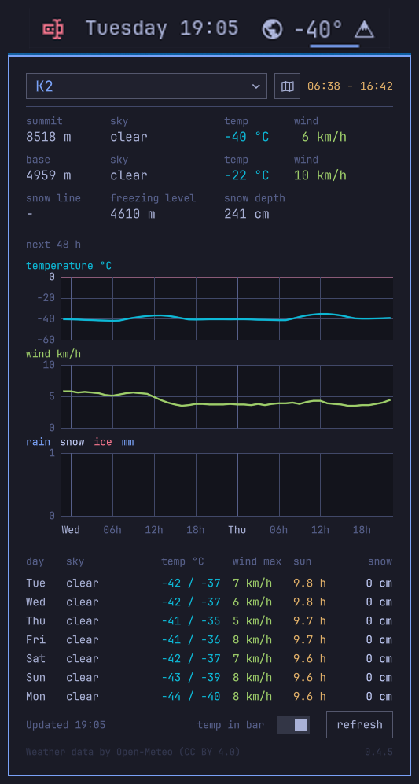
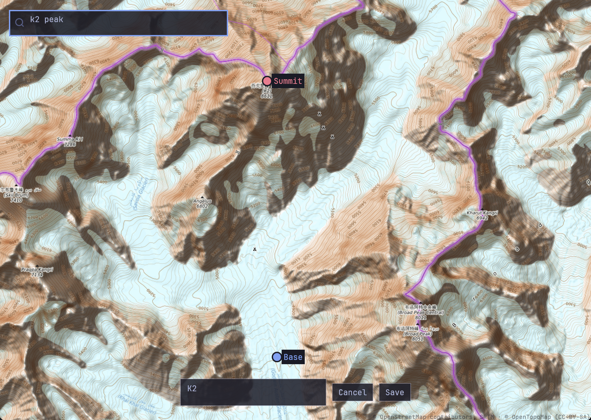
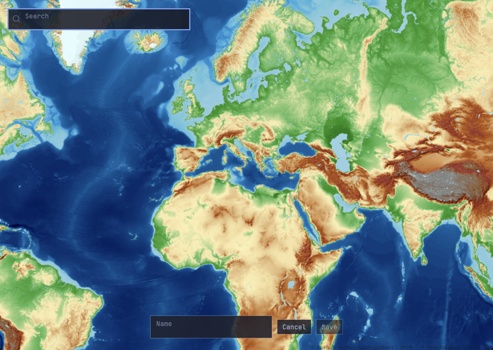

# Peakcast for Omarchy

Mountain weather in the [Omarchy](https://omarchy.org/) bar, with the same panel as the Peakcast
app for the Mac: for each of your areas, summit and base, wind at the height of the summit, snow
line, freezing level and charts for the next hours.

The plugin shows what the [Peakcast](https://github.com/alrubearb-sys/peakcast) engine prints, so
the engine has to be installed first.



## Install

1. Install the engine. Until the AUR package is ready, take it from the latest
   [release](https://github.com/alrubearb-sys/peakcast/releases) (use `aarch64` instead of `x86_64`
   on ARM):

   ```
   cd /tmp
   curl -LO https://github.com/alrubearb-sys/peakcast/releases/download/v0.4.5/peakcast-0.4.5-x86_64-linux.tar.gz
   tar xzf peakcast-0.4.5-x86_64-linux.tar.gz
   install -Dm755 peakcast-0.4.5-x86_64-linux/peakcast peakcast-0.4.5-x86_64-linux/peakcast-map -t ~/.local/bin/
   ```

2. Add an area, for example `peakcast add Säntis`.

3. Add the plugin:

   ```
   omarchy plugin add https://github.com/alrubearb-sys/peakcast-omarchy --enable
   ```

4. To pick summits and bases on the map, let its window float: add this line to
   `~/.config/hypr/hyprland.lua`:

   ```
   o.window("^peakcast-map$", { tag = "+floating-window" })
   ```

The plugin needs Peakcast 0.4.5 or newer. To have it next to Omarchy's weather, drag it in the bar
or run `omarchy bar move io.github.alrubearb-sys.peakcast --section center`.

## Use

- Click the mountain to open the panel. The first area in the list is the one it opens on.
- The list at the top searches places and holds your areas: drag them to order them, the pencil
  edits one on the map, the cross removes it. With the keyboard: arrows, Enter, Delete, and
  Ctrl+Up/Down to move an area.
- The map button opens the map: left click sets the summit, right click the base.
- When a new version is out, a faint link at the foot of the panel updates the engine, the map and
  the plugin in a terminal, as Omarchy updates itself.
- The "temp in bar" switch at the foot of the panel, or a right click on the mountain, shows the
  temperature at the top of the first area next to the icon, as Omarchy shows the battery's
  percentage. It is off at first.
- `omarchy-shell io.github.alrubearb-sys.peakcast refresh` asks for the forecast again.
- `omarchy-shell io.github.alrubearb-sys.peakcast toggleTemperature` switches the temperature on
  or off.

The panel for K2 with its temperature in the bar, and the map where its summit and base were picked:

<p>
  
  
</p>

The map covers the whole world, so an area can be anywhere:



## Remove

```
omarchy plugin remove io.github.alrubearb-sys.peakcast
rm ~/.local/bin/peakcast ~/.local/bin/peakcast-map
```

Your areas stay in `~/.config/peakcast` and the caches in `~/.cache/peakcast`; delete those folders
too to remove everything.

## Requirements

- The [Peakcast](https://github.com/alrubearb-sys/peakcast) engine (`peakcast`), which the plugin runs
  to read the forecast. The plugin itself makes no network requests; the engine asks Open-Meteo for
  the forecast, Nominatim for place searches and GitHub, every 6 hours, for a newer release.

## License

MIT. Weather data by [Open-Meteo](https://open-meteo.com/) (CC BY 4.0).
